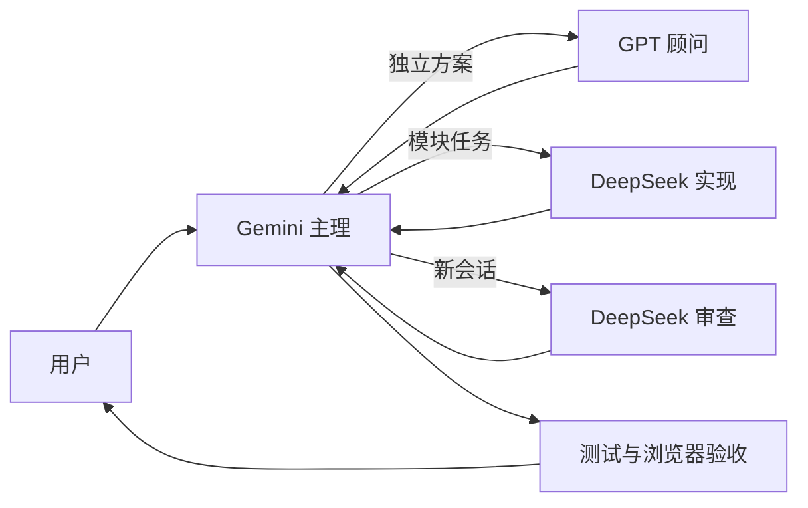

# Multi-Agent Collaboration

用 Gemini、GPT 与 DeepSeek Harness 组成一条有主次的开发工作流。Gemini 负责理解需求、协调和验收，GPT 提供独立方案，DeepSeek 负责约定范围内的实现、审查与浏览器操作。

[快速开始](#快速开始) · [工作流](#工作流) · [任务模板](templates/) · [使用边界](#使用边界) · [来源](#来源)

## 快速开始

1. 准备可用的 Gemini、Codex 和 DeepSeek Harness。具体安装、登录、模型与权限配置请参考各工具的官方文档。
2. 将 [主理人指引](templates/orchestrator.md) 提供给 Gemini，并说明项目背景与任务。
3. 需要重要方案时，用 [独立规划模板](templates/planning.md) 向 GPT 传递用户需求和必要事实。Gemini 同时独立思考。
4. 需要独立实现时，让 Gemini 用 [实现任务模板](templates/implementation.md) 给 DeepSeek 分配任务。
5. 修改完成后，用 [审查模板](templates/review.md) 开启新的只读会话。Gemini 核实审查结果、运行测试并交付。

本仓库提供工作流和可复制的任务模板。跨工具调用需要根据自己的环境配置。

## 工作流

### 规划

小修改由 Gemini 直接处理。架构、数据设计、长期依赖等重要决策，分别交给 Gemini 和 GPT 思考。GPT 只接收用户原话和必要背景，以便保留独立视角。Gemini 对照代码、文档和测试证据核实分歧，汇总方案。

### 实现

Gemini 负责前端、视觉、交互、联调和集成。DeepSeek 处理接口明确、可以独立开发的后端、算法和数据模块。任务书应写明接口、修改范围、约束和验收方式。

### 审查与交付

DeepSeek 在独立会话中审查具体改动，指出问题位置、触发条件和影响。Gemini 复核问题、修正代码、重跑测试，并按实际结果交付。多步骤网页验收可以使用 [浏览器任务模板](templates/browser.md)。

## 使用边界

- 本项目描述一种分工方式，模型能力和产品功能会随版本变化。
- 模型调用会产生额度或 API 费用。把任务内容发送给模型前，请确认相应数据可以共享。
- 文件修改、浏览器操作和命令执行受各工具的权限与运行环境影响。审查结论需要结合实际测试。
- 工作区应提供任务所需的上下文。并行修改同一文件时需协调或使用隔离工作区。

## 验证记录

在一次 Windows 环境试运行中，Gemini 调用 GPT 规划，DeepSeek 实现并在新会话审查一个丢包率模块，Gemini 运行的四项测试全部通过。DeepSeek 浏览器席位也完成了本地页面的点击与结果读取。一次测试进程启动遇到 Windows ACL 错误，由 Gemini 在同一版本上补跑。实际可用性取决于本地工具版本、认证和权限。

## 来源

工作流受 [数字生命卡兹克的多模型协作文章](https://www.woshipm.com/ai/6498266.html) 启发，按 Gemini、GPT 和 DeepSeek Harness 的角色重新整理。工具用法以各自官方文档为准。

## 贡献

欢迎通过 issue 分享复现问题、改进模板或补充经过验证的配置。提交前请移除密钥、个人路径、会话记录及敏感数据。
